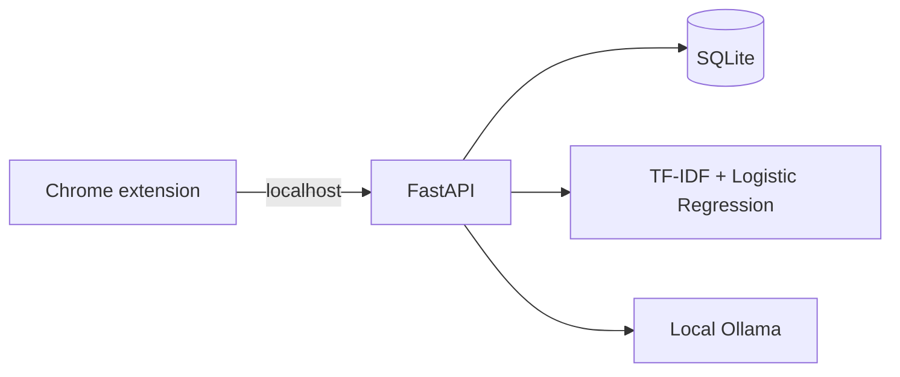

# Automatic Form Filler

A local-first Chrome extension and FastAPI service for reviewing and filling web forms from a personal profile. It is designed for applications, registrations and similar forms. It never submits a form.

## Privacy model

Profile data, CV files, approved answers, SQLite data, the field model, and optional LLM generation all run on the user's machine. The backend is intended to run only on `127.0.0.1`; the extension only calls that local address. There is no account system, cloud database, analytics, or external AI API. This architecture reduces data transmission; it does not make a device invulnerable to compromise.



## Install and run

```powershell
cd backend
python -m venv .venv
.venv\Scripts\activate
pip install -r requirements.txt
python training/train.py
uvicorn app.main:app --host 127.0.0.1 --port 8000
```

Install [Ollama](https://ollama.com/) separately and pull the model configured by `OLLAMA_MODEL` (default `llama3.2:3b`). Ollama is optional until generating long-form answers.

In Chrome, open `chrome://extensions`, enable Developer mode, click **Load unpacked**, and select `extension/`.

Use `tests/form-playground.html` as a safe local form-detection test page. Configure profile data through the documented REST endpoints at `http://127.0.0.1:8000/docs` before scanning a form.

## How field matching works

The extension collects labels, `for` labels, placeholders, names, IDs, ARIA information, nearby text and select choices—including elements inside open shadow roots. The API applies precise rules first, then a locally stored TF-IDF/logistic-regression model. Low-confidence matches are returned without a value and are never silently filled. Every supplied value remains editable and must be selected in the extension before it changes the page.

The detector supports standard inputs, textareas, selects, checkboxes, radio inputs and contenteditable regions. It cannot access cross-origin iframes or closed shadow DOM, and a site may block scripted DOM changes; rescanning handles newly rendered dynamic fields.

## CV and answers

`POST /cv/upload` accepts PDF and DOCX up to 10 MB, parses them locally, and returns data for mandatory review. Long-form questions use only focused local profile/CV context and locally running Ollama. Generated text is validated and still requires user review. Approved answers can be stored under `/answers` for local similarity-based reuse.

## Testing

```powershell
cd backend
python -m pytest tests -q
python training/evaluate.py
node --check ..\extension\content.js
```

The included evaluation is a small seed dataset, so its training-set score is not a claim of real-world generalization. Add diverse, held-out field language before relying on ML mappings for high-stakes submissions.

## Permissions

The extension asks for `activeTab`, `scripting`, and local `storage`; `host_permissions` is restricted to the local backend. Its content script is available on pages only to perform a user-triggered scan/fill workflow.

## Safety

The extension does not include form submission logic. Use `POST /settings/delete-all-data` with `{"confirm": true}` to remove profile records, answers, and stored CV files.
