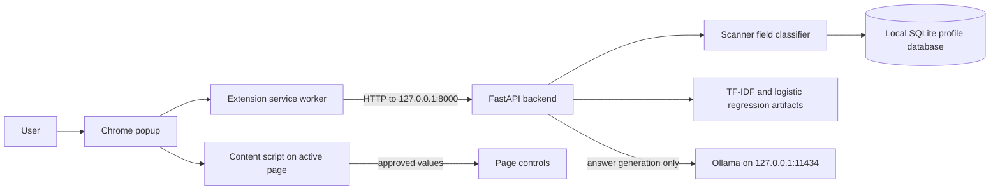

# AutoForm

AutoForm is the local-first Chrome extension and Python API that helps a person review and fill web forms from information they have saved in a local profile. It can map ordinary fields to saved values and draft answers for open-ended questions using a local language model. It does not submit forms.

This README describes the implementation in this repository. The API reference in [`docs/api.md`](docs/api.md) provides another route-oriented view, and FastAPI serves interactive OpenAPI documentation at `http://127.0.0.1:8000/docs` while running.

## Contents

- [What the system does](#what-the-system-does)
- [Architecture and data flow](#architecture-and-data-flow)
- [Requirements and setup](#requirements-and-setup)
- [Using the extension](#using-the-extension)
- [How scanning works](#how-scanning-works)
- [How profile mapping works](#how-profile-mapping-works)
- [Training the field classifier](#training-the-field-classifier)
- [When the LLM is used](#when-the-llm-is-used)
- [Profile data and database](#profile-data-and-database)
- [CV extraction](#cv-extraction)
- [HTTP API reference](#http-api-reference)
- [Configuration](#configuration)
- [Privacy and security](#privacy-and-security)
- [Known limitations](#known-limitations)
- [Troubleshooting](#troubleshooting)
- [Repository layout](#repository-layout)

## What the system does

1. The extension inspects visible, enabled write-in controls in the active page and describes each control to the local backend.
2. The backend chooses a likely profile field from the control's labels, HTML metadata, question text, section, and (as a fallback) a small trained classifier.
3. It loads the actual saved value from the profile database. For a select menu it can choose the closest real option when the match is sufficiently plausible.
4. If there is no saved value and the control looks like a long written response, the extension offers a generated draft. Draft generation uses local Ollama and evidence from the profile, CV, and prior saved answers.
5. The user reviews and edits suggestions, approves fields, and asks the extension to fill those controls. The page is never submitted by AutoForm.

The scanner and ordinary profile mapping do not use an LLM. The field classifier is a deterministic rules and metadata system with a small TF-IDF / logistic-regression fallback. Ollama is used only for open-ended answer generation.

## Architecture and data flow



### Components

- **Popup** (`extension/popup.html`, `extension/popup.js`, `extension/styles.css`) starts a scan, renders mapped and unmatched fields, offers answer generation, and sends the user's approved values for filling.
- **Content script** (`extension/content.js`) inspects and labels controls in the current page, retains DOM-element handles for this page context, and applies fill operations.
- **Service worker** (`extension/background.js`) proxies health, classification, answer generation, and saved-answer requests to the backend at `http://127.0.0.1:8000`.
- **FastAPI backend** (`backend/app/main.py`) provides the dashboard, local API, database operations, classification, CV handling, and answer-generation orchestration.
- **Field services** (`backend/app/services.py`) implement text normalization, matching rules, profile-value lookup, dropdown option matching, answer-context assembly, and Ollama prompts and validation.
- **SQLite database** stores the user's profile and related records under `backend/data/app.db` by default.
- **Field model** is loaded from two local Joblib files under `backend/models/`. Training is an explicit developer command and does not happen at application startup.
- **Ollama** is an optional local model server used only by `/answers/generate`.

The extension calls only the configured localhost backend. The code has no cloud account, analytics service, or external model API integration.

## Requirements and setup

### Requirements

- Windows, macOS, or Linux with Python 3.10 or newer recommended.
- Google Chrome or a Chromium browser supporting Manifest V3 extensions.
- Ollama and a compatible local text model only if written-answer generation is wanted.

Install Python dependencies and start the local backend from the `backend` directory:

```powershell
cd backend
python -m venv .venv
.venv\Scripts\activate
pip install -r requirements.txt
python training/train.py
uvicorn app.main:app --host 127.0.0.1 --port 8000
```

The API creates database tables on startup. The field model training command is separate because model artifacts are ignored by Git and the API does not train on startup. If the two model artifacts are absent, deterministic rules still work; the learned fallback is simply unavailable until training is run.

For answer generation, install Ollama separately, start its local service, and download a model, for example:

```powershell
ollama pull qwen3:4b
```

The configured default is `qwen3:4b`. The backend first uses the configured model if it is installed, then tries configured fallback names. If none of those are installed, it chooses the largest locally listed non-embedding model. The model must fit the host machine's resources. Ollama is not required to scan a form or map saved profile data.

Load the extension in Chrome:

1. Visit `chrome://extensions` and enable **Developer mode**.
2. Select **Load unpacked** and choose this repository's `extension/` directory.
3. Keep the backend running at `127.0.0.1:8000`.
4. Open the local profile dashboard at `http://127.0.0.1:8000/` and save profile details before scanning.
5. Navigate to a form and open the AutoForm extension popup.

[`tests/form-playground.html`](tests/form-playground.html) is a local page for trying supported form controls. Chrome internal pages such as `chrome://extensions` cannot be scanned.

### Updating the backend URL

The API address is currently a constant in `extension/background.js`, and the host permission in `extension/manifest.json` must authorize the same address. If changing the port or host, update both. The documented default binds only to loopback for local use.

## Using the extension

When opened on a normal page, the popup checks backend health and scans the current page. The popup displays a summary and a review list. Fields with saved values appear as mapped suggestions; open-ended fields can request a concise, standard, or detailed draft; unmatched fields remain visible for review. Generated answers can be edited before filling.

The extension may preselect suggestions with values in the review UI, but filling happens only after the user presses **Fill approved fields**. The content script writes values to the identified controls, dispatches input/change events for framework-controlled forms, and does not click submit buttons or submit the form. The user remains responsible for checking the site and submitting it themselves.

## How scanning works

### Controls considered

The content script looks for enabled, visible text-entry controls, including:

- Text-like `<input>` controls except hidden, submit, button, reset, image, file, password, checkbox, radio, search, range, and color controls.
- `<textarea>`, `<select>`, and supported `contenteditable` elements.
- ARIA `textbox`, `combobox`, and `spinbutton` controls.

Native checkbox and radio controls are intentionally excluded from scanning in the current write-in workflow. The script contains lower-level choice-handling helpers, but those controls are not part of the candidate selector and are skipped by collection. Do not assume checkbox/radio groups will be presented as normal mapped fields.

### Page traversal and visibility

The scanner starts from the document, visits open shadow roots to a maximum depth of six, and scans accessible same-origin `iframe` and `frame` documents. It cannot inspect cross-origin frames or closed shadow roots. Shadow-root traversal is capped at 4,000 nodes per root to bound work on large pages.

It excludes disabled controls and checks the control and ancestors for hidden/inert state, `display`, `visibility`, zero opacity, tiny bounds, and common clipping. It also skips page chrome and wrapper elements that contain nested controls. These heuristics reduce accidental scans but cannot perfectly infer the intent of every custom site widget.

### Field descriptions sent to the backend

For each candidate the script creates an ephemeral ID such as `aff_0`, keeps an in-memory reference to the DOM element, and sends a `FieldIn` description. Descriptions can include:

- Element tag and control type.
- `name`, `id`, placeholder, ARIA label, and HTML `autocomplete` value.
- The best label or question text found from associated labels, ARIA labelling, wrapper text, nearby preceding text, or other attributes.
- Section and nearby text, which help disambiguate repeated labels such as "Start date" under Education versus Work Experience.
- Whether the field is required, visible, and its current value.
- Choices and option values for supported select/listbox controls.

The backend schema also accepts `question_hint`, a full `question`, and other metadata so both extension and API clients can use the classifier. The extension's element IDs are temporary page-session handles, not database identifiers.

### Duplicate reduction

The collector tracks elements by object identity, omits a parent if it wraps nested controls, then checks same-document candidates for equal normalized labels and equal control types whose rectangles overlap by more than 90 percent of the smaller control. This suppresses common duplicate representations of the same visible field. It can still miss duplicates whose labels differ or incorrectly treat unusual overlapping controls as duplicates; no browser-independent heuristic can guarantee perfect detection on arbitrary page markup.

### Writing values back

The popup sends approved IDs and values back to the content script in the same tab. The script verifies the element handle and applies values to inputs, textareas, selects, editable regions, and supported ARIA widgets. It uses a native value setter and dispatches `input`, `change`, and blur-related events for compatibility with React/Vue-style controlled inputs. Dates are normalized for date controls. Select values are selected from the page's actual options when the backend found a match. Filling is not a guarantee that a site's custom JavaScript will accept the change, so the user should inspect the result.

## How profile mapping works

The classifier's job is to infer a profile key, such as `personal.phone` or `education.institution`. It is separate from value lookup: after inferring a key, the backend reads the value from the corresponding database record. It does not generate a profile value with the LLM.

### Classification cascade

For each field, `FieldClassifier.predict` in `backend/app/services.py` applies signals in this order:

1. **HTML autocomplete.** Known semantic tokens such as `email`, `tel`, `given-name`, `organization-title`, `bday`, and address tokens map directly to canonical profile fields.
2. **Section-aware generic name.** A plain `Name` in an Education, Work Experience, or Projects section maps to the institution, company, or project name. Identifiers can refine a generic label.
3. **Curated hints.** Word-boundary phrase hints are scored against the primary label/question text. Negative patterns suppress known dangerous interpretations, for example treating a company-name prompt as the applicant's own name.
4. **Curated regular-expression rules.** More structured patterns recognize field phrases such as employment dates, job title, organization, degree, or descriptions. More specific matches and section context influence candidate ordering.
5. **HTML input type.** Types such as `email`, `tel`, and `url` provide a fallback. A date control uses its label and section to distinguish employment dates and education dates from date of birth.
6. **Control identifiers.** If a visible label is generic, normalized `name` and `id` identifiers are checked for hints and rules. Framework-generated prefixes and separators are normalized before matching.
7. **TF-IDF model.** If rules and metadata do not resolve the field, the trained text classifier predicts a canonical field from the field's descriptive text. This is a fallback, not an LLM.
8. **Context fallback.** The section and nearby text may yield a lower-confidence match when the field itself has little useful text.

The implementation prioritizes primary field text such as the actual label, question, and placeholder. Nearby container text has less influence, reducing the chance that words from an adjacent question map the wrong field. Section groups add weight to education/work/project records and reduce inappropriate personal-name matches inside those sections.

### Mapping keys and stored value resolution

The classifier maps personal details including full, first, and last name; email; phone; location; address; date of birth; LinkedIn; GitHub; portfolio; headline; summary; languages; and current company. It also maps relevant collections for education, experience, skills, and projects, including institution, degree, field, dates, grade, company, position, descriptions, project details, and skills.

The resolver reads the profile singleton (`id=1`) or a collection record from SQLite. First and last names are derived from the saved full name by treating the last whitespace-separated token as the last name. Skills are returned as a comma-separated list. Collection values currently come from the first record ordered by database ID; multiple education/jobs/projects are not selected by matching dates or employer context. If no education end date exists, graduation year is used as a fallback. If no experience company exists, the profile's current company is used.

For `<select>` fields, the resolver compares the stored value to both displayed option text and underlying option values. Exact and substring matches score highly; token overlap handles mild wording differences. A best score below `0.34` does not choose an option. Placeholder options are excluded by the scanner or avoided during filling. The user can review the result before it is applied.

### Confidence, review, and generated answers

The classifier returns a mapped key, confidence, and a source label such as `autocomplete`, `hint`, `rule`, `type`, `identifier`, `ml`, or `context`. The API's default suggestion threshold is `0.60`; below it, the result has no accepted mapped field. A result below the `0.90` auto-fill threshold is marked `requires_review`. The popup shows the value and lets the user review it regardless.

Classification then checks the saved value. **A saved value wins over open-ended answer generation.** Only when there is no usable mapped profile value does the backend check whether the field looks like an essay or written response. Long text controls are candidates for generation unless they match a structured long-text profile field with high confidence. Fields with email, phone, URL, date, number, or select types are not classified as open-ended.

This ordering prevents ordinary questions such as phone number or college from being offered as an LLM writing task when an appropriate saved value exists. It cannot eliminate every ambiguity: a missing value, unusual label, custom control, or multiple collection records may still need human correction.

## Training the field classifier

### What is trained

The learned component is a traditional supervised text classifier for field-label classification. It is not a generative model and is not the same model as Ollama. Its purpose is to provide a fallback guess for which saved-data key a field corresponds to when explicit metadata and curated matching rules do not decide the case.

Training data is [`backend/training/dataset.csv`](backend/training/dataset.csv), a UTF-8 CSV with `text` and `label` columns. Each row pairs a sample of field wording with a canonical output label such as `personal.email`, `education.institution`, or `experience.position`. The samples are seed examples maintained with the source code. They are not gathered from the user's profile or browsing history.

### Training procedure

Run from the `backend` directory:

```powershell
python training/train.py
```

The script:

1. Reads all CSV rows with Python's `csv.DictReader`.
2. Fits scikit-learn's `TfidfVectorizer` with lowercase text, unigrams and bigrams (`ngram_range=(1, 2)`), and sublinear term frequency.
3. Transforms each sample into a sparse TF-IDF feature vector.
4. Fits `LogisticRegression` with `max_iter=2000`, balanced class weights, and `random_state=42`.
5. Saves the vectorizer as `backend/models/tfidf_vectorizer.joblib` and classifier as `backend/models/field_classifier.joblib` using Joblib.

The class labels come from the `label` column. The model has no neural network, embedding service, online learning, or user-specific training step. It uses the features and classes present when the command runs.

### Evaluation and interpretation

Run:

```powershell
python training/evaluate.py
```

The evaluator loads the same CSV and saved artifacts, predicts those rows, and prints scikit-learn's classification report and confusion matrix. It evaluates against the examples used for fitting, so this is a smoke check of the artifacts and label wiring, **not** a held-out accuracy estimate and not evidence of performance on arbitrary production forms. To measure generalization, create a diverse held-out dataset, split it before training, and report metrics on examples never seen during fitting.

### Improving the data

When adding examples, use a range of realistic labels, question wording, abbreviations, capitalization, and common framework-generated identifiers for each supported canonical label. Include confusable labels in different sections, such as `Name` under applicant details, education, work experience, and projects. Keep labels consistent with the existing canonical keys and avoid placing near-duplicate text with conflicting labels. After editing the CSV, retrain with `python training/train.py` and evaluate with an appropriately held-out set before relying on results.

The model only receives text assembled from a field's label, question hint, question, placeholder, ARIA label, autocomplete token, normalized `name`/`id`, section, and limited nearby text. It never receives the saved profile value as an input feature. The deterministic rules execute first and can override any learned fallback.

## When the LLM is used

### LLM is not used for

- Reading the DOM or scanning fields.
- Deciding ordinary field-to-profile mappings.
- Looking up profile values in SQLite.
- Deriving first/last name from a saved full name.
- Comparing a saved value against a select menu's options.
- Extracting text from the supported CV formats.
- Assembling the `/context` response.

Those steps use browser DOM APIs, Python code, matching rules, scikit-learn, database queries, PyMuPDF, and python-docx.

### LLM is used for

Only `POST /answers/generate` calls a generative model. The flow is:

1. `context_for` identifies a question category and gathers matching evidence from the profile, skills, experience, education, projects, prior approved answers, and relevant CV excerpts. It orders evidence for the question and caps the assembled context using `ANSWER_CONTEXT_CHARS` (default 6,000 characters).
2. `question_guidance` selects focused instructions for categories such as motivation, introduction, leadership, challenge, weakness, project, skills, education, availability, compensation, research, and cover-letter style questions.
3. The backend lists local Ollama models at `/api/tags`, selects the configured or fallback model, and caches the choice briefly. It sends a non-streaming request to Ollama's local `/api/generate` endpoint with the question, evidence, missing-information notes, writing instructions, and selected answer length.
4. The prompt asks for first-person writing, a direct answer, exact copying of names/dates, no invented facts, no placeholders, and no unsupported details. Concise, standard, and detailed modes have different word targets and hard limits.
5. The backend cleans the response, removes common preambles, deduplicates sentences, checks first-person voice, relevance, unsupported proper nouns/numbers, and placeholders, and may make one correction request if diagnostics find a problem. It then trims to the configured word limit and returns a draft with metadata.
6. The popup displays the draft for editing and approval. Approved answers can be saved locally to the previous-answers table. They are not automatically submitted to the website.

Ollama is configured to use `http://127.0.0.1:11434` by default. No prompt is sent to a hosted model by this code. A locally running server and an installed model are required for generation. `/health` reports backend/model availability and probes Ollama model selection. `/context` can inspect evidence without making an LLM call. If no evidence exists, answer generation returns HTTP 422; if Ollama is unavailable, it returns HTTP 503.

Generated answers are drafts, not verified facts. Automated grounding checks are imperfect, and a model can still phrase evidence poorly or infer something unsupported. The user should review each answer.

## Profile data and database

By default, SQLAlchemy stores data in `backend/data/app.db`. Tables are created during API startup. The startup migration helper adds missing columns to existing tables for supported schema changes; it is not a general-purpose migration framework.

| Table | Stored information |
| --- | --- |
| `profile` | One profile row with name, email, phone, location, address, birth date, web profiles, headline, summary, languages, current company, graduation year, work authorization, visa status, availability, notice period, salary expectation, references, certifications, awards, and interests. |
| `education` | Institution, degree, field, start/end dates, grade, description. |
| `experience` | Company, position, start/end dates, description. |
| `skills` | Unique skill names. |
| `projects` | Name, description, technologies, role, URL. |
| `previous_answers` | Question and approved answer, with created/updated timestamps. |
| `cv_documents` | Original filename, extracted text, created timestamp. |

CV source files are stored below `backend/data/uploads/cv/` by default. The database stores extracted text for answer context. Uploading a new CV replaces the database's current CV record; the uploaded file is written under a generated filename. The delete-all endpoint removes files in the configured CV upload directory along with database records.

## CV extraction

`POST /cv/upload` accepts PDF and DOCX files, with a default maximum size of 10 MiB. PDF text is extracted with PyMuPDF. DOCX paragraphs and tables are read with python-docx. Scanned/image-only PDFs do not receive OCR in this implementation and may be rejected as having no readable text. Extracted content is saved locally, truncated to 100,000 characters for the CV record/API response, and divided into sections for preview and evidence selection. The response marks the CV for review; users should check extraction quality, especially for tables and unusual layouts.

CV sections and relevant excerpts can contribute evidence to answer generation. The CV is not independently passed to a generative model during scanning or mapping.

## HTTP API reference

All routes are served on the local backend. Interactive request/response schemas are available at `/docs`. The primary routes are:

| Method and path | Purpose |
| --- | --- |
| `GET /health` | Backend status, whether the classifier loaded, configured Ollama URL, and selected/configured answer model. |
| `GET /` | Local profile dashboard. |
| `GET /profile`, `PUT /profile`, `DELETE /profile` | Read, replace, or remove the profile singleton. |
| `GET /education`, `POST /education`, `PUT /education/{item_id}`, `DELETE /education/{item_id}` | Education CRUD. |
| `GET /experience`, `POST /experience`, `PUT /experience/{item_id}`, `DELETE /experience/{item_id}` | Experience CRUD. |
| `GET /projects`, `POST /projects`, `PUT /projects/{item_id}`, `DELETE /projects/{item_id}` | Project CRUD. |
| `GET /skills`, `POST /skills`, `DELETE /skills/{item_id}` | List, add, or delete a skill. Duplicate skill names return HTTP 409. |
| `GET /answers`, `POST /answers`, `PUT /answers/{item_id}`, `DELETE /answers/{item_id}` | CRUD for saved previous answers. |
| `POST /fields/classify` | Classify a list of field descriptions and resolve saved values. |
| `POST /context` | Return gathered answer evidence, selected question kind, sources, and missing information without calling Ollama. |
| `POST /answers/generate` | Generate and validate a local-model answer draft. |
| `POST /answers/validate` | Validate a supplied answer against available context. |
| `POST /answers/save` | Insert or update an approved answer by exact question text. |
| `POST /cv/upload`, `GET /cv` | Upload a PDF/DOCX CV and retrieve the latest extracted text/sections. |
| `POST /settings/delete-all-data` | Delete profile-related records and files after explicit confirmation. |

### Classification request example

```json
{
  "fields": [
    {
      "id": "aff_0",
      "tag": "input",
      "type": "tel",
      "label": "Phone number",
      "section": "Personal information",
      "required": true,
      "options": [],
      "option_values": []
    }
  ]
}
```

Each result includes the input `id`, `mapped_field`, `confidence`, `value`, `option_value`, `kind`, `source`, `requires_review`, and `detected_label` as applicable. Open-ended results use `kind: "open_ended"` and include the extracted question. The response preserves one result for each input even if a single field fails internally.

### Generation request example

```json
{
  "question": "Why are you interested in this role?",
  "length": "standard"
}
```

`length` is `concise`, `standard`, or `detailed`. The response includes the draft, confidence and relevance estimates, sources, missing facts, detected question kind, a validity flag, and validation message. These estimates are programmatic indicators, not a guarantee of factual correctness.

### Error behavior

- `404` is used when updating or deleting a record that does not exist.
- `409` indicates a duplicate skill name.
- `413` indicates a CV exceeds the configured byte limit; `415` indicates an unsupported extension; `422` indicates invalid input, an unreadable CV, or no profile evidence for generation.
- `503` indicates the local Ollama call failed during answer generation.
- The classification endpoint isolates errors per field where possible, so one unresolvable field does not prevent results for the rest of the submitted fields.

## Configuration

Optional settings are loaded from `backend/.env` using Pydantic Settings. Defaults are declared in `backend/app/config.py`.

| Setting | Default | Purpose |
| --- | --- | --- |
| `DATABASE_URL` | SQLite file at `backend/data/app.db` | SQLAlchemy connection string. |
| `UPLOAD_DIR` | `backend/data/uploads/cv` | Directory for uploaded CV files. |
| `MODEL_DIR` | `backend/models` | Directory containing the two Joblib classifier artifacts. |
| `OLLAMA_BASE_URL` | `http://127.0.0.1:11434` | Local Ollama server base URL. |
| `OLLAMA_MODEL` | `qwen3:4b` | Preferred installed generation model. |             
| `OLLAMA_FALLBACK_MODELS` | A comma-separated list in `config.py` | Preferred local alternatives if the configured model is not installed. |
| `ANSWER_CONTEXT_CHARS` | `6000` | Maximum assembled answer evidence characters, constrained to 1,000 through 20,000. |
| `AUTO_FILL_THRESHOLD` | `0.90` | Confidence boundary for `requires_review` metadata. |
| `SUGGEST_THRESHOLD` | `0.60` | Minimum classifier confidence for accepting a mapping. |
| `MAX_CV_BYTES` | `10485760` | Maximum uploaded CV size in bytes. |

The extension's backend URL is currently fixed in `extension/background.js`; changing the backend host also requires updating the extension permission in `extension/manifest.json`.

## Privacy and security

The default setup binds the backend to loopback (`127.0.0.1`). Profile records, CV text/files, prior answers, and classifier artifacts are stored locally. Answer prompts go to the local Ollama endpoint configured for the backend. The extension requests `activeTab`, `storage`, and `scripting`, with a host permission for the local backend; its content script is declared for pages so it can inspect the active page when the popup workflow requests fields.

This design avoids sending form/profile content to a remote service in the shipped code. It does not encrypt the local SQLite database or uploaded files, protect against malware or other local users, or validate that a user-provided Ollama endpoint is trustworthy. Use a trusted machine, secure OS account, and local endpoint configuration. Do not bind the development server to a public interface without adding appropriate authentication and transport protections.

To remove local profile records, prior answers, CV database entries, and files in the configured upload directory, call:

```powershell
Invoke-RestMethod -Method Post -Uri http://127.0.0.1:8000/settings/delete-all-data `
  -ContentType 'application/json' -Body '{"confirm":true}'
```

This operation is destructive. It does not delete the Python environment, model artifacts, or unrelated files outside the configured upload directory.

## Known limitations

- Form markup varies widely. Hidden-state heuristics, label association, duplicate detection, and custom widget support cannot be perfect across every site.
- Cross-origin iframes and closed shadow roots are inaccessible to the content script.
- Checkbox and radio inputs are excluded from the current scan, despite helper functions for writing choice values.
- For a collection mapping, current value resolution takes the first record by database ID. It does not infer which of multiple jobs, schools, or projects a site is asking about.
- A learned-classifier confidence is not a calibrated probability. Use it as a ranking signal and review mappings, particularly on unfamiliar forms.
- The seed classifier evaluation reuses training examples. It does not measure generalization.
- Select option matching is approximate, and sites can use custom dropdown implementations that differ from native select behavior.
- CV extraction does not perform OCR on image-only PDFs.
- Ollama output and automated grounding checks can be wrong. Review generated content before filling or submitting it.
- A successful fill event does not guarantee that a site's own validation or controlled UI accepted the value.

## Troubleshooting

| Symptom | Checks |
| --- | --- |
| Popup reports backend unavailable | Start Uvicorn on `127.0.0.1:8000`; check that the extension URL and manifest permission match. Open `/health` in the browser. |
| No fields found | Use a normal webpage rather than a Chrome internal page; confirm visible enabled write-in controls exist; check whether the form is inside a cross-origin frame or closed shadow root. |
| Fields map to the wrong profile key | Inspect the field label, section, `name`, `id`, and `autocomplete`; add/verify the saved profile data; inspect the returned `source` and confidence. Update matching rules or training samples for repeatable wording. |
| Correct key but blank value | Add the data in the dashboard or relevant collection. For collection fields, confirm at least one record exists. |
| Wrong dropdown choice | Confirm the profile wording matches an actual option. Review the suggestion before filling; approximate option matching has a minimum score threshold. |
| Generate answer fails | Confirm Ollama is running at `OLLAMA_BASE_URL`, the selected model is installed (`ollama list`), and the profile/CV provides relevant context. Generation requires Ollama; mapping does not. |
| Model says no useful evidence | Add relevant profile, experience, education, projects, skills, previous approved answers, or readable CV text. `/context` shows evidence selection without generation. |
| CV upload fails | Use a valid PDF or DOCX under the configured size limit. Image-only PDFs need OCR outside this implementation. |

## Repository layout

```text
backend/
  app/
    main.py              FastAPI routes and startup
    config.py            Local settings and defaults
    database.py          SQLAlchemy engine/session and schema helper
    models.py            SQLAlchemy tables
    schemas.py           Request validation models
    services.py          Scanning classification, value mapping, CV and LLM logic
    static/              Local profile dashboard
  training/
    dataset.csv          Supervised field-label examples
    train.py             Fit and save TF-IDF/logistic-regression artifacts
    evaluate.py          Classification report and confusion matrix
  tests/                 Backend test suite
extension/
  manifest.json          Manifest V3 permissions and entry points
  popup.html             Popup structure
  popup.js               Scan/review/generate/fill workflow
  styles.css             Popup styling
  content.js             Page field discovery and value application
  background.js          Local API message proxy
docs/
  api.md                 Compact endpoint and payload reference
tests/
  form-playground.html   Local form scanning playground
```

The Python dependencies are listed in [`backend/requirements.txt`](backend/requirements.txt). Model artifacts, the SQLite database, uploaded CV files, virtual environments, and test caches are excluded by `.gitignore` and are created locally as needed.
